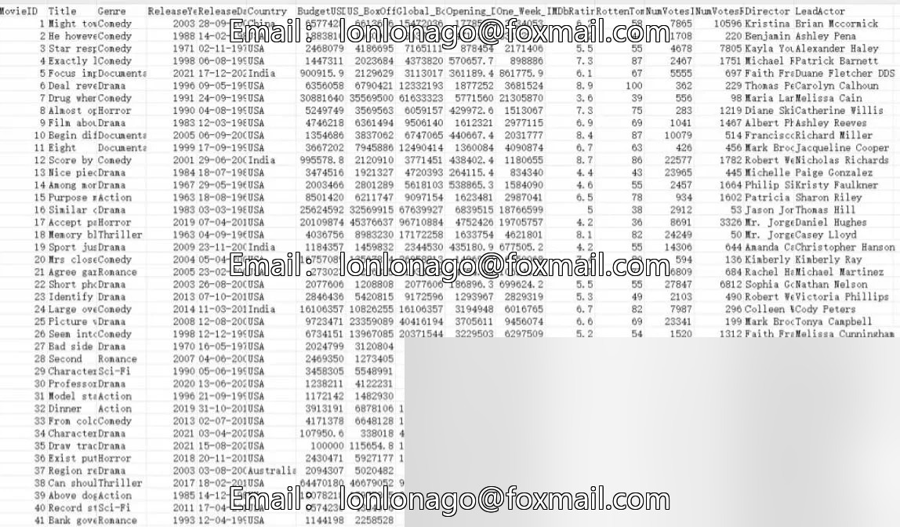

# 1.0 million composite movie dataset

## Body

1.00 million comprehensive movie dataset

The dataset comprehensively compiles movie data, covering qualitative and quantitative features. Each record reflects a unique movie. Information: identity, type, release date, production country, financial performance, audience reaction, and information about the main participants.

+Identifiers and metadata: unique movie ID, title, type, and release details.
+Financial metrics: early sales performance, domestic (U.S.) and international box office performance, and budget.
+Contributors: detailed information on directors and main actors.
+Audience and review reactions: Rotten Tomatoes score, IMDb score, and corresponding vote counts.

[Applicable]: 
Exploratory data analysis (EDA): discover the popularity, profitability, and creation trends of films.
Comparative research: study patterns of different types, different countries, and different publication years.
Predictive model: predict financial success, ratings, or audience engagement.
Recommended system uses voting and ratings to recommend films.

The dataset provides a solid foundation for data analysis, visualization, and machine learning applications in the film industry by providing a balanced combination of descriptive, financial, and evaluation information.

web-based shipment, can be directly photographed and shipped.

The dataset contains 1 million movies with qualitative and quantitative features, including identity, genre, release date, financial performance, audience reactions and main participants.

<!-- AI_ENRICHED -->

## Images

## Payment

Here is a pay link on Stripe ( https://buy.stripe.com/3cs8yP7sY87d0vu9AB ). Please contact me lonlonago@foxmail.com after funding $89, and I will send you a complete data files , thank you!

